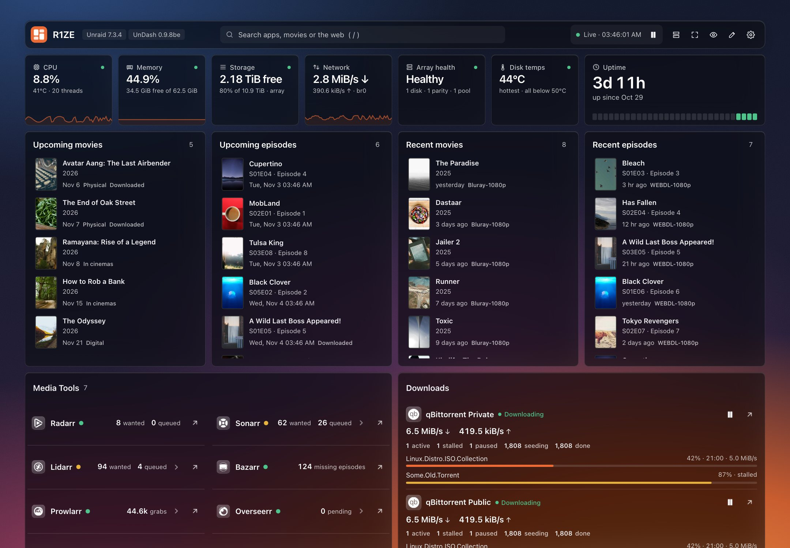
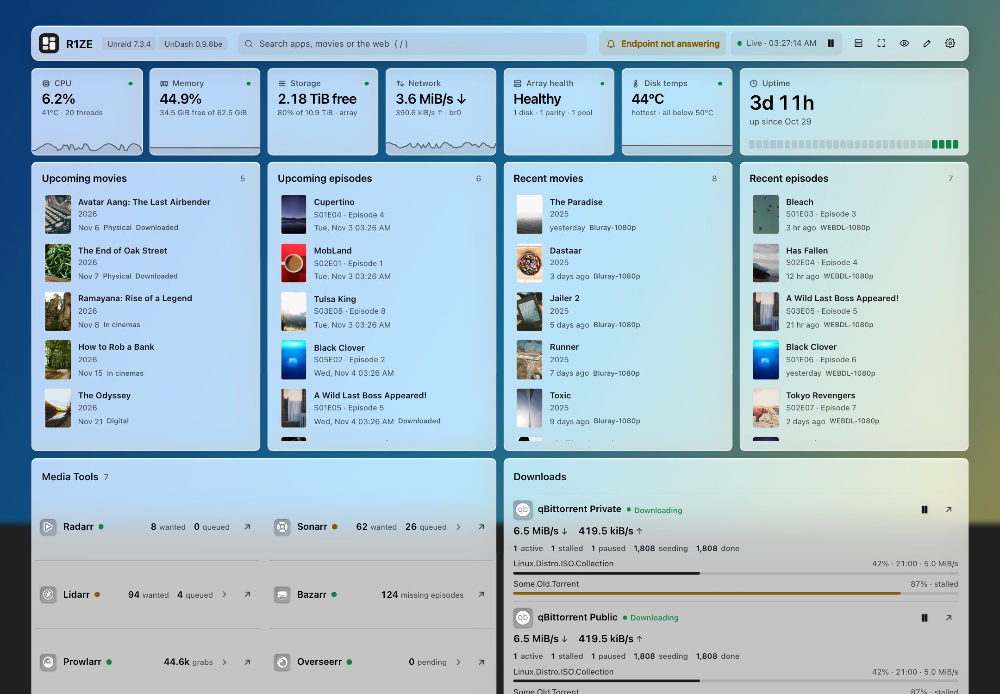
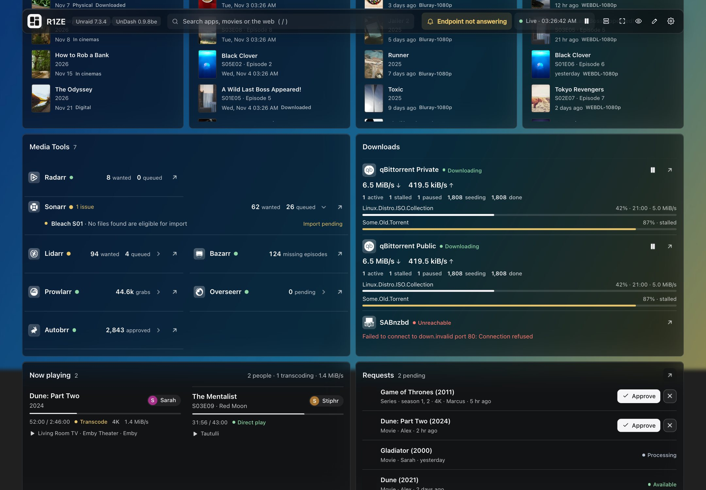
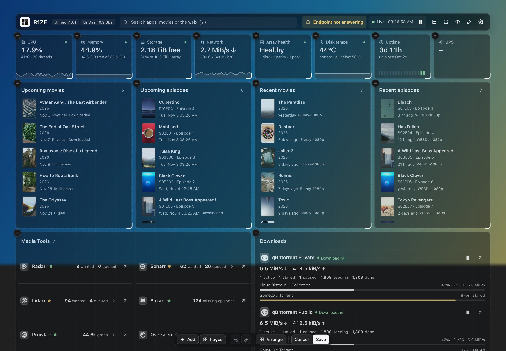
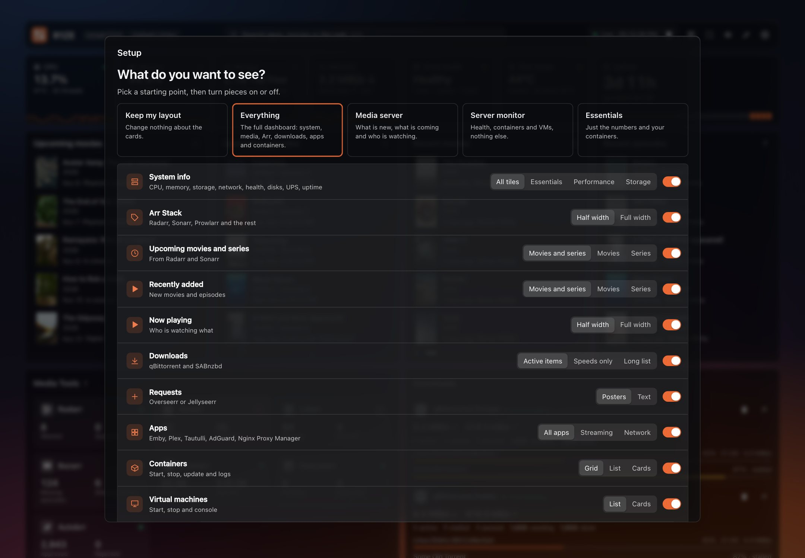
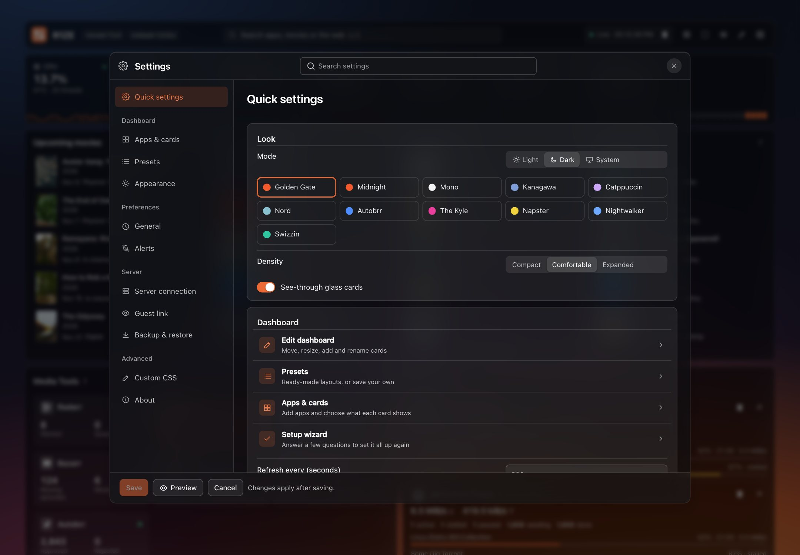
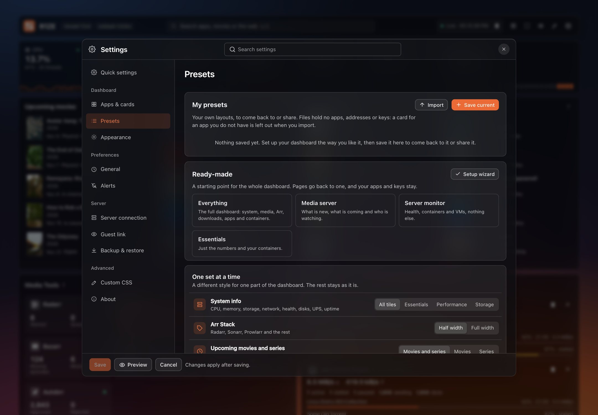
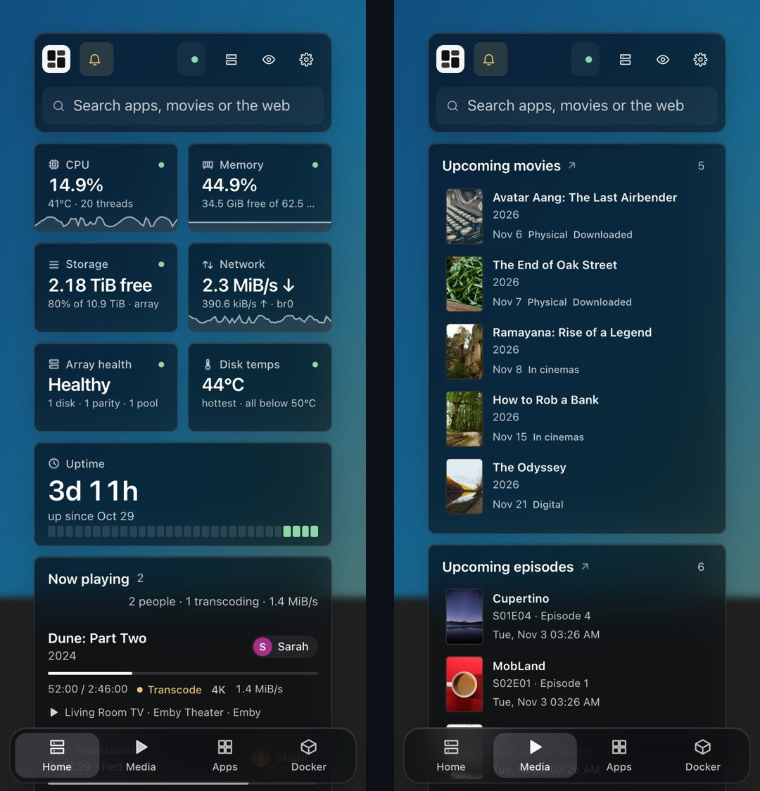

<p align="center"></p>

# UnDash

A compact dashboard for Unraid. System health, alerts, media, Arr apps, downloads, requests, containers and VMs on one page, with the controls to manage them.

<p align="center"></p>

> [!WARNING]
> **UnDash is entirely vibe coded (written with AI) and is still a work in progress.** Expect bugs and changes between versions. It can start, stop, restart and update containers and VMs on your server. Use it at your own risk: I am not responsible for anything that happens to your system or your data. Keep backups of your appdata and flash drive.

- **System**: CPU, memory, storage, network, array health, disk temperatures, uptime and UPS, with short history charts.
- **Alerts**: problems only (unhealthy or restarting containers, disk errors and heat, array state, updates). Each alert can be ignored for a while or for good. A history keeps when each problem started and ended.
- **Array details**: click Storage or Array health for the last parity check, Mover status, each disk's SMART status and when the array will be full at the current pace.
- **Push alerts**: Discord, Telegram, ntfy or Gotify, set up in **Settings > Alerts**. Sent when a problem lasts over a minute and when it ends, also with no dashboard open.
- **History charts**: click CPU, Memory, Network, Storage or Disk temps for the last hour, day, week or month. A reading is kept every minute.
- **Media**: upcoming and recently added movies and episodes from Radarr and Sonarr.
- **Arr Stack**, **Downloads** (qBittorrent, [qui](https://github.com/autobrr/qui), SABnzbd), **Now playing** (Plex, Emby, Jellyfin, Tautulli) and **Requests** (Overseerr / Jellyseerr, with approve and decline).
- **Containers and VMs**: start, stop, restart, update and logs from one gear menu, with CPU and memory per container. Click an icon or name to open its web UI. A badge shows which containers have an update; update from there, skip that version or ignore that container.
- **Your own layout**: move and resize every card in place, split the dashboard into pages, and let **Smart arrange** line everything up. Edit mode also has the theme, navbar and other Appearance settings right beside your cards.
- **Privacy**: **Hide sensitive details** covers names and titles with clean bars, for screenshots or a shared screen. A read-only **guest link** shows family and friends what you choose.
- **Endpoint health**: HTTP status and latency of every app and container web UI.
- **Search**: a list under the search box with your apps, containers and VMs, a web search and movies and series to request in Seerr. You choose which in Settings; the dashboard itself is never filtered.
- Ten themes with light and dark versions, frosted-glass wallpapers, custom CSS. Works on phones too, and goes on the home screen with its own icon (full screen on iPhone; on Android that needs HTTPS).

## Screenshots

| | |
|---|---|
|  |  |
| **Light mode.** Every theme has both | **Arr Stack, Downloads, Now playing and Requests.** Problems open under the app |
|  |  |
| **Edit dashboard.** Move, resize, add and remove cards in place | **Setup wizard.** Picks your layout and connects your apps |
|  |  |
| **Quick settings.** The first page of Settings | **Presets.** Save, share and import your own layouts |

<p align="center"></p>

The screenshots use made-up sample data.

## Install

UnDash comes as a **Docker container** (recommended) or as an Unraid **plugin**.

| | Docker container | Plugin |
|---|---|---|
| Reads the server through | the official Unraid API (an API key) | Unraid's own files and commands |
| Sign-in | its own password (optional) | your Unraid login |
| Not available | container CPU / memory, server restart and shutdown, Unraid OS updates, VM hibernate, NUT UPS | — |

### Docker container

**1. Create an API key.** In Unraid, go to **Settings > Management Access > API Keys > Create**. Give it read access to *Info, Array, Disk, Docker, VMs* (and *UPS* if Unraid's own UPS service runs yours), and update access to *Docker* and *VMs* if you want the start, stop and update buttons. Copy the key.

**2. Add the template.** In Unraid's terminal:

```bash
wget -O /boot/config/plugins/dockerMan/templates-user/my-UnDash.xml https://raw.githubusercontent.com/Stiphr/UnDash/main/templates/undash.xml
```

**3. Create the container.** Go to **Docker > Add Container**, pick **UnDash** under *Template*, and fill in:

| Field | Value |
|---|---|
| WebUI port | `9099` (or any free port) |
| Config | `/mnt/user/appdata/undash-docker` |
| Unraid API address | `http://YOUR_SERVER_IP/graphql` (`https://…` if Unraid forces HTTPS) |
| Unraid API key | the key from step 1 |
| Dashboard password | optional; leave empty to choose it in the browser |

Prefer the command line? This does the same:

```bash
docker run -d --name UnDash --restart unless-stopped -p 9099:9099 \
  -v /mnt/user/appdata/undash-docker:/config \
  -e UNRAID_API_URL=http://YOUR_SERVER_IP/graphql -e UNRAID_API_KEY=YOUR_KEY \
  ghcr.io/stiphr/undash:latest
```

**4. First start.** Open `http://YOUR_SERVER_IP:9099`.
- **Set a password (recommended):** enter the one-time setup code from the container log (**Docker > UnDash > Logs**) and choose a password of 10+ characters.
- **Continue without a password:** skips the code. Anyone who can reach the port can then use the dashboard. You can add a password later in **Settings > Server connection**.
  Without a password UnDash only answers at the server's IP address or name (`tower`, `tower.local`), so another web page cannot reach it through a host name of its own. Opening it through another name, such as a reverse proxy's, needs a password or that name in `UNDASH_ALLOWED_HOSTS`.

To update, use **Update** in the Docker tab. UnDash shows a badge next to its version when a new release is out.

**Try the release candidate:** the `ghcr.io/stiphr/undash:beta` image is the next version, now 1.0.0rc. Run it as a second container with its own port and config folder, so your stable dashboard stays as it is.

### Plugin

**Plugins > Install Plugin**, paste the URL below and press **Install** (Unraid 6.12 or later):

```
https://raw.githubusercontent.com/Stiphr/UnDash/main/undash.plg
```

Open it from the **UnDash** tab in Unraid's menu, or full-window at `http://YOUR_SERVER_IP:9099` (only for browsers signed in to Unraid).

## Set up

Everything is set up in **Settings** (the gear at the top right, or press `,`); you never have to edit a file. Changes take effect when you press **Save**; **Preview** next to it shows the dashboard with your changes first.

### Add apps

1. Go to **Settings > Apps & cards** and press **Add app**.
2. Pick the app type. Search, or browse by group. Containers UnDash recognises (Radarr, Plex, qBittorrent and so on) are listed first under **Found on your server**, with the name, address and icon already filled in:

   | Group | App types |
   |---|---|
   | Arr Stack | Radarr, Sonarr, Lidarr, Readarr, Prowlarr, Bazarr, autobrr, Overseerr / Jellyseerr, Wizarr |
   | Downloads | qBittorrent, qui, SABnzbd, Deluge, Transmission, NZBGet |
   | Media | Plex, Jellyfin, Emby, Tautulli, Tautulli recently added, Calendar, Tdarr, Unmanic, Navidrome, Audiobookshelf, Kavita, Komga, RomM, Jellystat, Tube Archivist, Ombi, Frigate |
   | Files and home | Nextcloud, Paperless-ngx, File Browser, Syncthing, Karakeep, Mealie, Miniflux, FreshRSS, Gitea / Forgejo, Gotify, changedetection.io |
   | Network and tools | AdGuard Home, Pi-hole, Technitium DNS, Nginx Proxy Manager, Traefik, Caddy, Gluetun, Headscale, UniFi, Immich, Home Assistant, PeaNUT |
   | Monitoring | Scrutiny, Uptime Kuma, Speedtest Tracker, Healthchecks, Gatus, Beszel, Netdata, Prometheus, Grafana, Glances, Portainer, What's Up Docker, Minecraft server |
   | Server | Storage, Docker summary, VM summary, UPS |
   | Widgets | Weather (Open-Meteo, no key), GitHub releases (with *Add from my containers*), Bookmarks |
   | Other | Custom API (JSON) for most other apps, Link for a plain shortcut |

3. Fill in the form:
   - **Address**: where UnDash reaches the app from the server, with the port, e.g. `http://192.168.1.10:7878`. Use the server's LAN IP, not `localhost`.
   - **API key**, or **Username** and **Password**: the form says where to find the key in that app (Radarr: *Settings > General*). They are saved in `.env` on the server and never sent back to the browser.
   - **Link** (optional): what opens when you click the app, if it differs from the address (a public HTTPS address, for example).
   - **Icon**: filled in for you. **Browse** searches about 5,000 icons by name, or type `sh-NAME` ([selfh.st icons](https://selfh.st/icons/)), `NAME.png` ([dashboard-icons](https://github.com/homarr-labs/dashboard-icons)) or an image URL.
   - **More options**: which numbers to show and other settings for that app type.
   - **Custom API**: choose *A row for each item of a list* to turn any JSON list into rows. Say where the list is (`data.results`) and write the rows with fields in braces: Title `{name}`, Second line `{status} · {size|bytes}`. Formats: `bytes`, `rate`, `percent`, `number`, `round`, `date`, `upper`, `lower`.
4. Press **Test**. It tries the app with what you filled in and shows the numbers it got, or the error. Nothing is saved yet.
5. Press **Add app**, then **Save**.

Each app lands in the right section by itself: the Arr apps in **Arr Stack**, download clients in **Downloads**, Calendar and Tautulli recently added in **Media**, Storage, UPS and the Docker / VM summaries in **System**, everything else in **Apps**. Radarr and Sonarr also fill **Media**, Plex, Emby, Jellyfin and Tautulli fill **Now playing**, and Overseerr fills **Requests**. To change an app later, find it under its section (or type its name in **Find an app**) and use edit, hide, star (favorite), drag to reorder, or remove.

Apps in the **Apps** section sit in groups. Open **Apps > Groups and apps** to add, rename and reorder groups, set the number of columns, and choose whether group names are shown.

**qBittorrent tip:** qBittorrent often skips the login for your own network, but UnDash connects from Docker's internal network, so always fill in the username and password. To use one value (a login, a server address) in several apps, add it under **Shared values** at the bottom of the page and type `{{NAME}}` in each app's field.

### Add containers and VMs

Containers and VMs need no setup: UnDash lists everything it finds on the server through the Unraid API (Docker version) or Unraid itself (plugin). Choose which ones the dashboard shows:

1. Go to **Settings > Apps & cards**.
2. Open **Containers** (or **Virtual machines**).
3. Under **Containers on the dashboard**, tick the ones to show. **Select all**, **Running only** and **None** act on everything the filter box lists, so you can type `arr` and press **Select all** to add every Arr container at once. New containers show until you untick them.
4. Per container you can also set a **display name**, an **icon**, **favorite** (star, also shown in the **Favorites** section) and whether it is **checked for updates** (arrow). A display name changes the dashboard only; the container keeps its real name. On a phone this list is the place to rename, because edit mode is for larger screens.
5. Pick the **layout** (compact grid, table or cards), **sort order**, what each container shows (CPU, memory, uptime, image) and which ones show by default: running, all, or **Selected**.
6. Press **Save**.

With a read-only API key the controls are hidden, and the dashboard stays useful for watching. If Unraid does not tell UnDash what the key may do, they disappear after the first refused action and are tried again an hour later.

The list stays empty until UnDash can read the server. In the Docker version, check **Settings > Server connection** and that the API key has read access to *Docker* and *VMs* (see [Install](#docker-container)).

On the dashboard, the gear on each container or VM has the controls: start, stop, restart, update, logs, **Show in "Selected"** and **Hide from the dashboard**. Click the icon or name to open its web UI.

**Updates:** a container with an update has a small badge on its icon, and the **Updates** filter lists them all. Click the badge to choose:

- **Update now**: pulls the new image and recreates the container, as Unraid's Docker tab does.
- **Skip this version**: hides this update, and the badge comes back by itself when a newer version comes out. The Docker version checks skipped images with their registry every 6 hours. Images you built yourself have no registry to ask, so use Ignore for those.
- **Ignore updates for this container**: no badge until you turn it back on.

To hide all update badges, turn off **Show updates** in the container options.

### Arrange the dashboard

Press the pencil at the top right to edit the dashboard in place. Nothing changes until you press **Save**, and **Undo** steps back through your changes, on every page. Edit mode needs a screen wider than a phone.

- **Move and resize:** drag a card, or drag its edges. Click a card for its options: name, which page it is on, and what it shows.
- **Add** brings back cards you removed and adds new apps. **Pages** adds and names pages. **Appearance** has the theme, accent colour, background, navbar, card style and size beside your cards.
- **Arrange** has the tools that do the work for you:

  | Tool | What it does |
  |---|---|
  | Smart arrange | lays out every card on the page and fits each one to its content, so nothing is cut off |
  | Smart arrange apps | lines up only the app cards in even rows; the other cards stay where they are |
  | Fit all to content | keeps the layout and fixes the heights |
  | Presets | ready-made layouts for the page, or for one set of cards |
  | Snap up | closes the gaps when you move a card |
  | Reset the layout | starts the page over |

- **Size an app:** click an app card and choose **Small**, **Medium**, **Large** or **Wide**. **Use for all apps** gives them all that size.

What each card shows is set in **Settings > Apps & cards** as well. Open a card there for its options:

| Card | Options |
|---|---|
| System | which tiles to show (CPU, memory, storage, network, health, disks, UPS…) and their order |
| Media | which columns (upcoming and recent movies and episodes), items per column, days ahead, which Radarr and Sonarr, posters or text only |
| Arr Stack / Downloads | their apps; how many active downloads per client |
| Requests | posters or text only |
| Apps | groups, group names, shortcut links |
| Containers / Virtual machines | see [Add containers and VMs](#add-containers-and-vms) |

App cards refresh every 15 seconds and the system every 2 seconds; change both in **Settings > General**.

### Setup wizard and presets

A new dashboard opens the setup wizard. It asks for a name, your Unraid connection, a password, what to show, which apps to connect and a look. Run it again from Settings > Presets. Your apps and keys stay, and you can keep your layout.

Presets come in two sizes. Whole dashboards: **Everything**, **Media server**, **Server monitor** and **Essentials**. Each set also has its own choices, such as System tiles (All, Essentials, Performance, Storage), Downloads (Active items, Speeds only, Long list) or Containers (Grid, List, Cards). Use them in the wizard, or in Edit dashboard > Arrange > **Presets**.

**Your own presets:** **Settings > Presets > Save current** keeps your cards, pages and views, and the look if you tick it. **Use** brings them back, and Preview shows the result before you save. **Export** writes a file and **Import** reads one. A file holds no apps, addresses or keys: on another server each card goes to the first app of that type, and a card with no match is left out.

### Pages

Edit dashboard > **Pages** adds and names pages, and **Split my cards** makes a first set from what you have: **Media** gets the media lists, Arr Stack, Downloads, Now playing and Requests, and **Apps** gets your app cards, Containers and VMs. Click a card to send it to another page. Each page keeps its own layout. With one page there are no tabs; with more, press 1 to 9 to switch. On a phone your pages replace the bottom tabs; with no pages the tabs are Home, Media and Apps.

### Without an Unraid API key

The Docker version reads and controls Unraid through its API, so without a key there are no containers, VMs or array details, and UnDash hides them rather than showing buttons that cannot work. Your apps, media, downloads, requests, feeds and push alerts for them work as usual, and everything comes back when you add a key.

If you run [Glances](https://github.com/nicolargo/glances), put its address in **Settings > Server connection** to get CPU, memory, storage, network and uptime back. It needs no key. Network speed only covers the whole server when Glances runs with host networking.

### Pick a look

**Settings > Appearance**: theme, light / dark / system mode, accent colour, spacing and wallpaper. The accent can follow the theme, be a colour of your own, or be taken from the wallpaper: UnDash reads a small copy of the picture in your browser and picks its main colour, toned so buttons and links stay readable. For the background choose the theme's gradient, a plain colour, a picture from an address, or **your own picture** (JPEG, PNG or WebP; it is scaled down in your browser and kept in the configuration folder, never sent anywhere). **Settings > Advanced > Custom CSS** for anything else.

### The navbar

**Settings > Appearance > Navbar**, or Appearance in edit mode: choose the search bar's width (Normal, Wide, Full width or Hidden) and which items to show: logo, dashboard name, Unraid version, UnDash version, clock, alerts and buttons. **Stay on top when scrolling** keeps the bar in view. The browser tab icon follows your accent colour, or uses your own logo if you set one.

### Start from the example

[`examples/config.yaml`](examples/config.yaml) is a complete working setup: 7 groups, 31 apps, all sections, Default theme, with no keys, passwords or real addresses.

1. Download it, then go to **Settings > Backup & restore > Import** and choose the file. You see what it contains before anything changes, and a backup is taken first.
2. In **Settings > Apps & cards**, change each address (`192.168.1.10` is a placeholder) and add the API keys; apps still missing one are marked. Remove the apps you don't run.

## Settings at a glance

| Where | What |
|---|---|
| Settings > Quick settings | the first page: mode, theme, density, shortcuts, and how the server is doing |
| Settings > Apps & cards | what the dashboard shows: sections, their options and your apps |
| Settings > Presets | your own presets (save, use, export, import), ready-made dashboards, a style per set, the setup wizard |
| Settings > Appearance | how it looks: theme, accent colour, background and wallpaper, size and spacing; Restore defaults puts the page back |
| Settings > General | dashboard name and icon, what the search box searches, refresh interval (default 2 s), disk path and UPS |
| Settings > Alerts | phone alerts, and alerts you have ignored |
| Settings > Server connection | Docker: Unraid API and dashboard password. Plugin: settings folder and the 9099 port |
| Settings > Guest link | a private read-only address for family and friends |
| Settings > Backup & restore | automatic backups and Back up now, export and import `config.yaml` and `.env`, import from another dashboard, restore all defaults |
| Settings > Advanced | Custom CSS, and About: version, where the files are, action and alert history |

UnDash keeps two files in its config folder (`/config` in Docker, `/mnt/user/appdata/undash` for the plugin):

- **`config.yaml`**: everything you set in Settings. It never holds a key or password (apps refer to them by name, like `{{RADARR_API_KEY}}`), so it is safe to share.
- **`.env`** (mode 600): the API keys, user names and passwords you enter in Settings.

Both are backed up automatically after every settings save and before an import or restore; the last 7 different versions are kept (`data/backups`). Settings from older versions are converted on first start; the old files are kept in `data/legacy`. The format is described in [docs/CONFIG.md](docs/CONFIG.md).

Keyboard: `/` search · `r` refresh · `p` pause · `,` settings · `?` all shortcuts · `g` + a letter jumps to a section.

## Guest link

Settings > **Guest link** makes a private address for family or friends. It is read-only and has its own session, so opening it does not sign you out. Choose what it shows: System, Media, Now playing and each app. New apps stay private until you tick them. It never shows containers, VMs, downloads, requests, alerts, addresses or Settings. **New link** ends the old address at once.

Anyone with the link can open it, so share it like a password. Set a dashboard password as well: without one, the plain address still opens everything.

## Security

- Every action is a fixed, validated operation on a known container or VM; nothing from the browser is run as a command.
- The Docker image runs unprivileged as uid 99, with no Docker socket: everything goes through the Unraid API with the key you scope.
- Sessions are HttpOnly with CSRF protection and a strict Content-Security-Policy.
- Password guessing is slowed down hard: 5 wrong tries lock an address out for 15 minutes, and each lockout after that lasts twice as long, up to a day. Repeated wrong passwords raise an alert with the address. The commonest passwords are refused. If you lock yourself out, restart the container.
- Keys and passwords stay on the server, and a saved one is only sent to the address it was saved for. Moving an app to a new address asks for its key again.
- Port 9099 is plain HTTP. Use it on your LAN, or put a reverse proxy with HTTPS in front. Behind a proxy, set `UNDASH_TRUSTED_PROXIES` to its address, so each visitor counts on their own for wrong passwords and sign-in cookies are marked Secure.
- **Set a dashboard password.** Without one, anyone who can reach the port can use the dashboard and control your containers, and none of the sign-in protection above applies.
- Certificates of the apps UnDash reads are not checked by default (LAN apps mostly use self-signed ones). Set `UNDASH_TLS_VERIFY=1` in the container settings to check them.
- Numbers typed into Settings are checked before they can be saved; a value the server still has to bring inside its limits is named after saving, never changed in silence.

More detail: [docs/DOCKER.md](docs/DOCKER.md) (Docker version) · [docs/CONFIG.md](docs/CONFIG.md) (settings file format).

## Development

Plain PHP 7.4+ with vanilla JS and CSS, no build step for the app. `python3 build.py 0.6.0` writes `undash.plg`; pushing a `vX.Y.Z` tag builds and publishes the Docker image.

```bash
php tests/run.php && php tests/api_mode_test.php && php tests/router_test.php && php tests/docker_auth_test.php
php -S 127.0.0.1:8088 dev/server.php                          # local preview with fake data (plugin mode)
UNDASH_DEV_MODE=api php -S 127.0.0.1:8089 dev/server.php      # the same in Docker mode
```

## License

Apache 2.0. The Inter typeface is bundled under the SIL Open Font License 1.1 ([docs/licenses/Inter-OFL.txt](docs/licenses/Inter-OFL.txt)). Theme palettes are built from the MIT-licensed [Kanagawa](https://github.com/rebelot/kanagawa.nvim), [Catppuccin](https://github.com/catppuccin/catppuccin), [Nord](https://www.nordtheme.com) and [Tokyo Night](https://github.com/folke/tokyonight.nvim) schemes and the [shadcn/ui](https://ui.shadcn.com) neutral and zinc scales.
